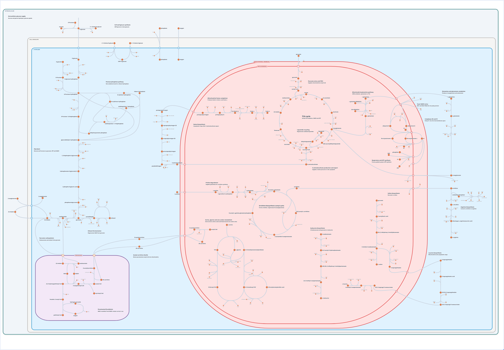
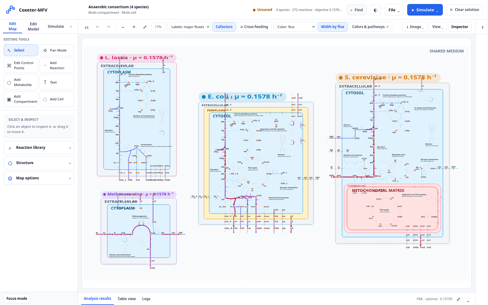
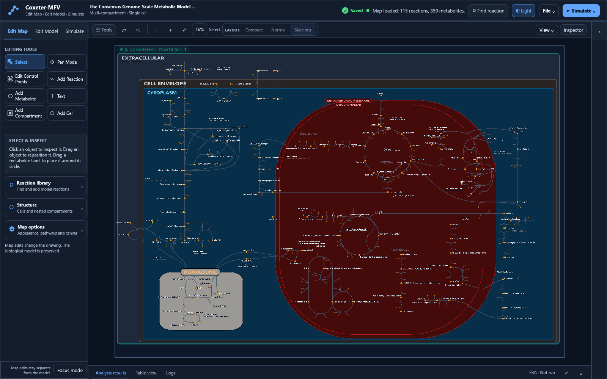
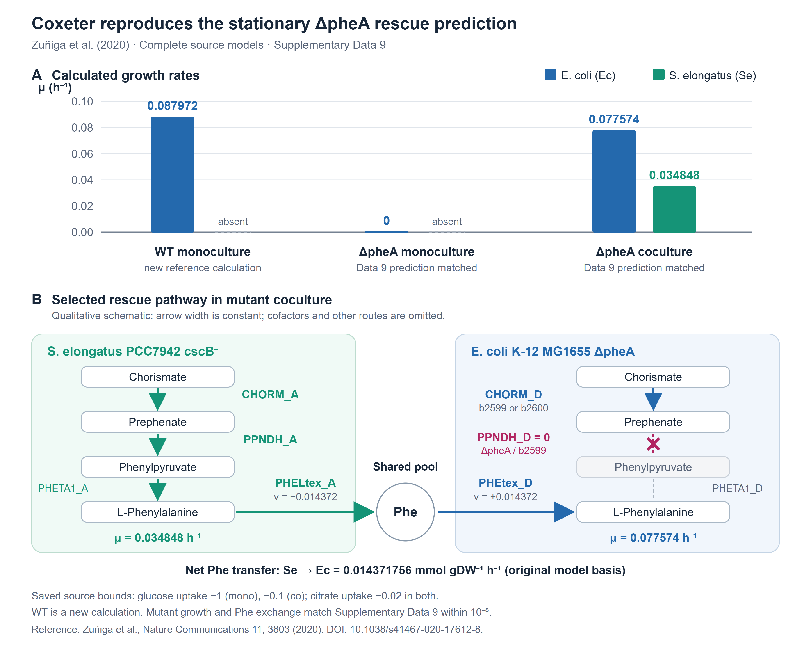

<div align="center">

# Coxeter-MFV

**Coxeter Multicell Flux Visualizer**

Metabolic maps with explicit cells and subcellular compartments, and flux balance analysis of single organisms and microbial communities.

[](LICENSE)
[](docs/USER_GUIDE.md)
[](app/coxeter_mfv.html)
[](app/coxeter-mfv.exe)



<sub>Central and mitochondrial metabolism of <i>Saccharomyces cerevisiae</i> drawn over the Yeast9 genome-scale model, with the extracellular space, cell envelope, cytoplasm, mitochondrial membrane, mitochondrion and peroxisome as nested compartments. See <a href="examples/yeast9-cytosol-mitochondria-peroxisome">the example</a>.</sub>

</div>

## About

This is the official source and distribution repository for Coxeter-MFV. Application development takes place in EscherMultiCellMultiCompartment, and reviewed source snapshots and matching builds are promoted here. The current software version is **0.1.0**, in preparation for publication; an article reference and permanent release DOI have not yet been assigned in this repository.

Start with the [user guide](docs/USER_GUIDE.md), [reproducibility instructions](docs/REPRODUCIBILITY.md), or [support guide](SUPPORT.md). Maintainers should follow the [release procedure](docs/RELEASING.md) and [publication checklist](docs/PUBLICATION.md).

The [validation record](docs/VALIDATION.md) lists the checks performed and known limitations, including unresolved failures in the broader source-browser integration harness.

Coxeter-MFV draws metabolic networks the way cells are built. Every cell is a closed container with its own membrane, every compartment sits inside the one that holds it, and every transport reaction is placed on the membrane it crosses. Several organisms can share one map, each inside its own boundary and connected through a shared medium that is itself a drawn compartment.

The same application solves the network. Flux balance analysis and its variants run on the model behind the map, and the result is painted back onto it, so fluxes, cross-feeding between species and omics data can be read in their cellular context.

Coxeter-MFV was built for researchers who work with genome-scale metabolic models of eukaryotes and microbial communities. Explicit cell and compartment boundaries show where reactions happen and which membranes transported metabolites cross. That location is part of the map.

## Features

- **Compartment-aware maps.** Cells, organelles and membranes are first-class objects that can be drawn, nested, resized, reshaped and moved with everything they contain.
- **Microbial communities.** Several species in one map, each with its own abundance, exchanging metabolites through a shared medium.
- **Flux analysis.** FBA, parsimonious FBA, loopless FBA, CycleFreeFlux, flux variability analysis and SteadyCom community FBA, with live recalculation when bounds, medium or abundances change. The solution is drawn on the map as line colour and width, by signed or absolute flux.
- **Reactions and bounds.** Every reaction of the model in one table, grouped by type, compartment, species or pathway, with a slider and an exact value for each bound, any objective to maximise or minimise, gene knockouts evaluated through the gene rules, bulk edits, undo for every change and bounds exported to and imported from CSV.
- **Omics integration.** Gene expression and metatranscriptomics overlays, condition comparisons and GIMME context-specific models.
- **Cross-feeding explorer.** Every metabolite exchanged between species, filterable by producer, consumer and flux, drawn as routes on the map.
- **Map editor.** Add and remove reactions, metabolites, compartments and cells, adjust curves with control points, select several objects with a rectangle or Ctrl-click to align, distribute and rotate them or to lay a cycle such as the TCA cycle out as a circle, annotate with text, colour pathways, and undo any step.
- **Model editor.** Create metabolites and reactions in the biological model, separately from the drawing.
- **Open formats.** Models in SBML, COBRA JSON and the COBRA Toolbox MATLAB and Excel formats. Maps, scenarios and reproducibility bundles in JSON. Figures in SVG and PNG, fluxes in CSV, and a methods and provenance report for each analysis.
- **Two front ends, one behaviour.** A single HTML file that runs offline in any modern browser, and a native desktop application written in Rust with GPU rendering and the HiGHS solver, or Gurobi or CPLEX when they are installed.

## Gallery

<table>
<tr>
<td width="50%"></td>
<td width="50%"></td>
</tr>
<tr>
<td><sub>An anaerobic consortium of four species sharing one medium, solved with community FBA in the web application. Each cell shows its growth rate, and line width follows flux.</sub></td>
<td><sub>The 135-reaction Yeast9 map of the cytoplasm, mitochondrion and peroxisome over the genome-scale model, open in the Windows desktop application, dark theme.</sub></td>
</tr>
<tr>
<td colspan="2"></td>
</tr>
<tr>
<td colspan="2"><sub>Phenylalanine rescue of an <i>E. coli</i> ΔpheA mutant by <i>Synechococcus elongatus</i>, reproduced from the original models of Zuñiga et al. (2020) within an absolute tolerance of 10⁻⁸.</sub></td>
</tr>
</table>

## Getting started

### Web application

Download [`app/coxeter_mfv.html`](app/coxeter_mfv.html) using GitHub's **Download raw file** action, then open the downloaded file in a current browser. The application, solver and bundled teaching models run locally. No account or installation is required. External model downloads, including the Zuñiga source models and optional Yeast9 download, require internet access; imported models are processed on your computer.

### Windows desktop application

Download [`app/coxeter-mfv.exe`](app/coxeter-mfv.exe) and run it. The bundled models are compiled into the program, so it needs no other files. Models and maps can also be passed on the command line.

```powershell
coxeter-mfv.exe yeastgem_v9.1.1-edited.json yeast9_cytosol_mitochondria_peroxisome.json
```

### From source

The complete source of both applications, with their tests, is at the top level of this repository: the web application in [`src`](src) and the desktop application in [`rust`](rust). Building instructions for both are in [`docs/BUILDING.md`](docs/BUILDING.md).

### Container

The packaged browser application can also be served with Docker or Podman. From the repository root:

```bash
docker build -t coxeter-mfv .
docker run --rm -p 127.0.0.1:8080:8080 coxeter-mfv
```

Open `http://127.0.0.1:8080`. The container runtime and the initial image download are prerequisites. Calculations run in the browser.

Application checksums and source promotion provenance are recorded in [`release-manifest.json`](release-manifest.json). Run `node tools/release-manifest.mjs` from the repository root to verify them.

## Examples

Each example folder holds the model and map files needed to open it. The work each example comes from is cited in [`examples/README.md`](examples/README.md).

| Example | What it shows | Source |
| --- | --- | --- |
| [Yeast9 cytoplasm, mitochondrion and peroxisome](examples/yeast9-cytosol-mitochondria-peroxisome) | One eukaryotic cell with six nested compartments, 135 reactions and 408 metabolite nodes, from glycolysis and the pentose phosphate pathway to respiration and ATP export, heme biosynthesis and peroxisomal β-oxidation | Zhang et al. (2024) |
| [*D. vulgaris* and *M. maripaludis*](examples/stolyar-2007-syntrophy) | Syntrophic growth on lactate through hydrogen and formate transfer | Stolyar et al. (2007) |
| [Four auxotrophic *E. coli* strains](examples/steadycom-ecoli-auxotrophs) | Amino acid cross-feeding solved with SteadyCom, maximum community growth 0.73599 h⁻¹ | Chan et al. (2017) |
| [Nine-species gut community](examples/steadycom-gut-nine) | An 11009-reaction community model with a curated map of 1171 reactions in nine cells | Chan et al. (2017) |
| [*S. elongatus* and *E. coli* ΔpheA](examples/zuniga-2020-phea-rescue) | Phototroph to heterotroph phenylalanine cross-feeding from the authors' original models | Zuñiga et al. (2020) |

The literature communities open from the scenario list in both applications. The Zuñiga case downloads its pinned source models on demand; its saved reference results and map are bundled.

## Case studies of the article

The scripts, models, solutions and figures of the three case studies in the Coxeter-MFV article (the Yeast9 compartment map, the Zuñiga et al. phototroph–heterotroph community and the SteadyCom auxotroph community) are in [`paper`](paper). Its README maps each figure and table to the scripts that produce it.

## Repository structure

```text
coxeterMFV/
├── app/          ready-to-run applications (coxeter_mfv.html, coxeter-mfv.exe)
├── src/          web application (JavaScript)
├── assets/       stylesheets and the vendored GLPK solver
├── rust/         desktop application (Rust)
├── models/       bundled models, scenarios and published communities
├── test/         test suite of the web application
├── tools/        build, validation and release scripts
├── examples/     example maps and models from the literature
├── paper/        case studies of the article: scripts, results and figures
├── data/         original source data and its provenance
├── docs/         user guide, building, reproducibility and release notes
└── LICENSES/     licence texts of the bundled third-party components
```

## How to cite

Please cite the software and the exact version or commit used. [`CITATION.cff`](CITATION.cff) supplies software metadata for GitHub's *Cite this repository* action. The author list currently retains the collective attribution used by this repository, pending confirmation by the authors.

The publication reference and permanent software archive DOI will be added when assigned. Until then, record the software name, version, repository URL and access date. Do not use a placeholder article citation. The final release should be archived with a permanent DOI, separately from the article DOI.

When you use one of the examples, please also cite the work it comes from. The references are listed in each example folder.

## License

The source code of Coxeter-MFV is released under the [MIT License](LICENSE).

The single-file web application bundles the GLPK solver (glpk.js), which is licensed under the GNU General Public License version 3, so that file is distributed under GPL-3.0. The Windows application uses the HiGHS solver, which is MIT licensed. Gurobi and CPLEX are not bundled. The application opens them from the user's own licensed installation.

Models and datasets keep the licences of their original authors. Their sources and terms are listed in [`data/README.md`](data/README.md) and in each example folder.

Full third-party notices, GPL corresponding source and native dependency licences are indexed in [`THIRD_PARTY_NOTICES.md`](THIRD_PARTY_NOTICES.md). Some literature-derived data still need their redistribution terms confirmed before the publication release.

## Support and contributions

Use the [issue tracker](https://github.com/mathomics/coxeterMFV/issues) for reproducible bugs, usage questions and feature requests. See [SUPPORT.md](SUPPORT.md) for troubleshooting, [CONTRIBUTING.md](CONTRIBUTING.md) for the source promotion workflow and [SECURITY.md](SECURITY.md) for vulnerability reporting. Changes between releases are recorded in [CHANGELOG.md](CHANGELOG.md).

## Acknowledgements

The map conventions of Coxeter-MFV, from Bézier reaction curves to the separation of primary and secondary metabolites, follow those of [Escher](https://escher.github.io) (King et al. 2015). Flux problems are solved with [GLPK](https://www.gnu.org/software/glpk/) in the browser and [HiGHS](https://highs.dev) on the desktop. The yeast examples are built on the community model [yeast-GEM](https://github.com/SysBioChalmers/yeast-GEM).

## References

- Chan SHJ, Simons MN, Maranas CD (2017). SteadyCom: Predicting microbial abundances while ensuring community stability. *PLoS Computational Biology* 13(5), e1005539. https://doi.org/10.1371/journal.pcbi.1005539
- King ZA, Dräger A, Ebrahim A, Sonnenschein N, Lewis NE, Palsson BO (2015). Escher: A web application for building, sharing, and embedding data-rich visualizations of biological pathways. *PLoS Computational Biology* 11(8), e1004321. https://doi.org/10.1371/journal.pcbi.1004321
- Stolyar S, Van Dien S, Hillesland KL, Pinel N, Lie TJ, Leigh JA, Stahl DA (2007). Metabolic modeling of a mutualistic microbial community. *Molecular Systems Biology* 3, 92. https://doi.org/10.1038/msb4100131
- Zhang C et al. (2024). Yeast9: a consensus genome-scale metabolic model for *S. cerevisiae* curated by the community. *Molecular Systems Biology* 20(10), 1134–1150. https://doi.org/10.1038/s44320-024-00060-7
- Zuñiga C, Li T, Guarnieri MT, Jenkins JP, Li CT, Bingol K, Kim YM, Betenbaugh MJ, Zengler K (2020). Synthetic microbial communities of heterotrophs and phototrophs facilitate sustainable growth. *Nature Communications* 11, 3803. https://doi.org/10.1038/s41467-020-17612-8
