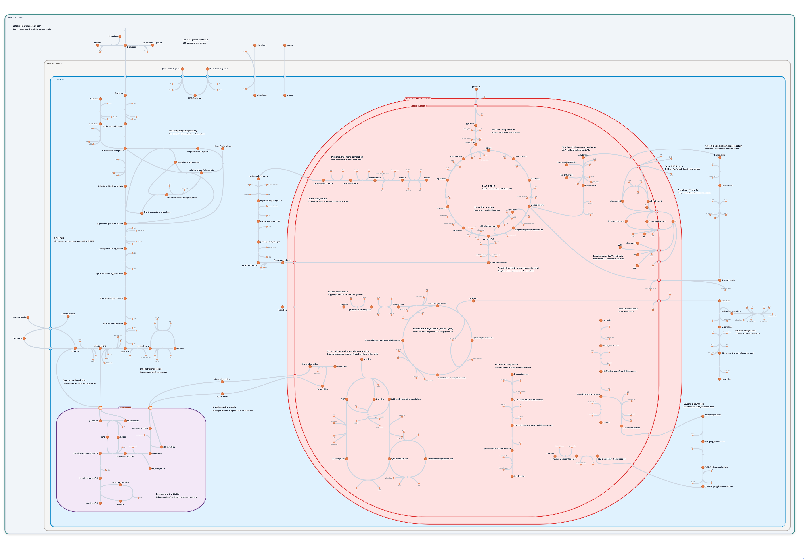
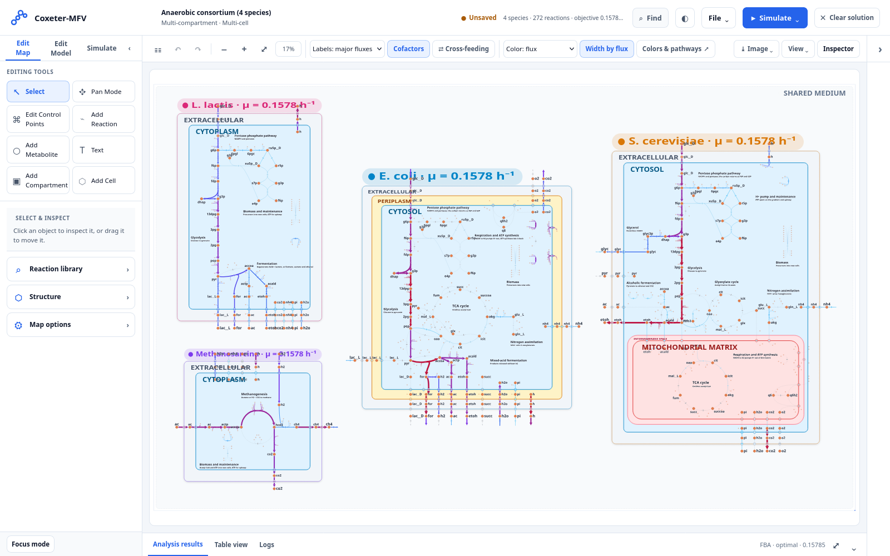
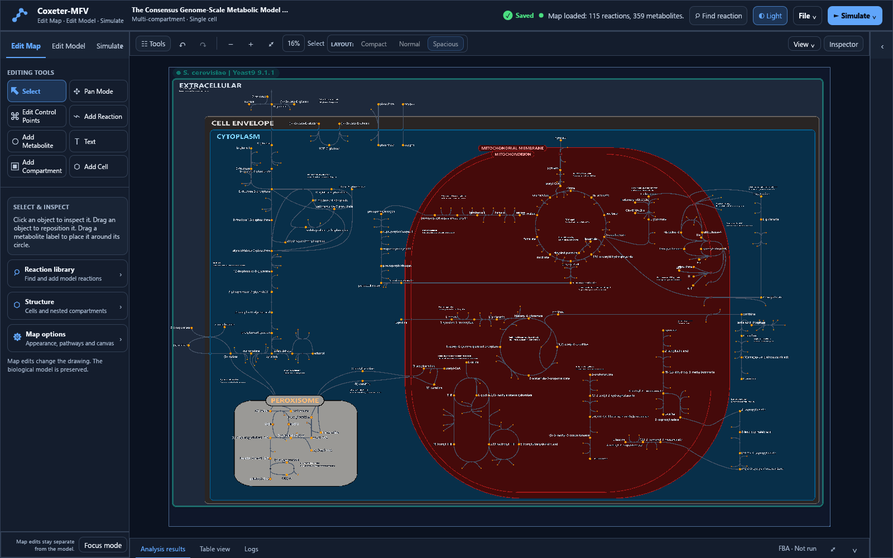
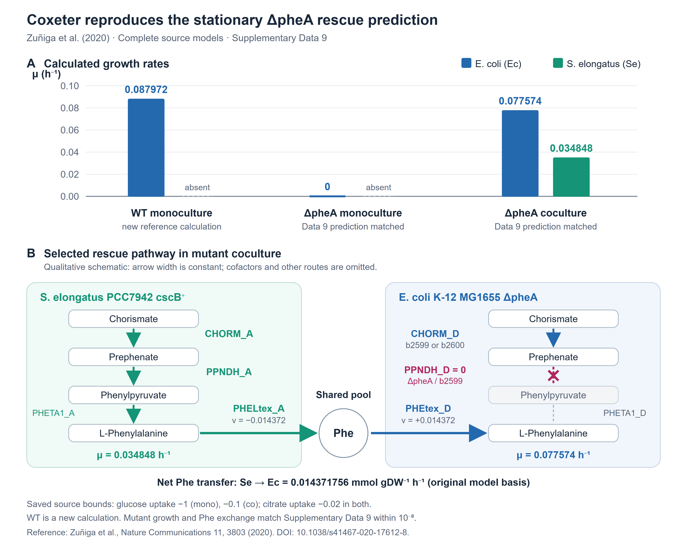

<div align="center">

# Coxeter-MFV

**Coxeter Multicell Flux Visualizer**

Metabolic maps with explicit cells and subcellular compartments, and flux balance analysis of single organisms and microbial communities.

[](LICENSE)
[](#how-to-cite)
[](app/web)
[](app/windows)



<sub>Central and mitochondrial metabolism of <i>Saccharomyces cerevisiae</i> drawn over the Yeast9 genome-scale model, with the extracellular space, cell envelope, cytoplasm, mitochondrial membrane, mitochondrion, peroxisome, ER membrane and lipid particle as nested compartments. See <a href="examples/yeast9-cytosol-mitochondria-peroxisome">the example</a>.</sub>

</div>

## About

Coxeter-MFV draws metabolic networks the way cells are built. Every cell is a closed container with its own membrane, every compartment sits inside the one that holds it, and every transport reaction is placed on the membrane it crosses. Several organisms can share one map, each inside its own boundary and connected through a shared medium that is itself a drawn compartment.

The same application solves the network. Flux balance analysis and its variants run on the model behind the map, and the result is painted back onto it, so fluxes, cross-feeding between species and omics data can be read in their cellular context.

Coxeter-MFV was built for researchers who work with genome-scale metabolic models of eukaryotes and microbial communities. Existing pathway viewers draw one flat canvas per organism, which leaves the question of where a reaction happens, and which membrane a metabolite crosses, to the reader. Coxeter-MFV makes that location part of the map.

## Features

- **Compartment-aware maps.** Cells, organelles and membranes are first-class objects that can be drawn, nested, resized, reshaped and moved with everything they contain.
- **Microbial communities.** Several species in one map, each with its own abundance, exchanging metabolites through a shared medium.
- **Flux analysis.** FBA, parsimonious FBA, loopless FBA, flux variability analysis and SteadyCom community FBA, with live recalculation when bounds, medium or abundances change.
- **Reactions and bounds.** Every reaction of the model in one table, grouped by type, compartment, species or pathway, with a slider and an exact value for each bound, any objective to maximise or minimise, gene knockouts evaluated through the gene rules, bulk edits, undo for every change and bounds exported to and imported from CSV.
- **Omics integration.** Gene expression and metatranscriptomics overlays, condition comparisons and GIMME context-specific models.
- **Cross-feeding explorer.** Every metabolite exchanged between species, filterable by producer, consumer and flux, drawn as routes on the map.
- **Map editor.** Add and remove reactions, metabolites, compartments and cells, adjust curves with control points, align and distribute, annotate with text, colour pathways, and undo any step.
- **Model editor.** Create metabolites and reactions in the biological model, separately from the drawing.
- **Open formats.** Models in SBML, COBRA JSON and the COBRA Toolbox MATLAB and Excel formats. Maps, scenarios and reproducibility bundles in JSON. Figures in SVG and PNG, fluxes in CSV, and a methods and provenance report for each analysis.
- **Two front ends, one behaviour.** A single HTML file that runs offline in any modern browser, and a native desktop application written in Rust with GPU rendering and the HiGHS solver, or Gurobi or CPLEX when they are installed.

## Gallery

<table>
<tr>
<td width="50%"></td>
<td width="50%"></td>
</tr>
<tr>
<td><sub>An anaerobic consortium of four species sharing one medium, solved with community FBA. Each cell shows its growth rate.</sub></td>
<td><sub>The Yeast9 cytoplasm, mitochondrion and peroxisome map open in the desktop application, dark theme.</sub></td>
</tr>
<tr>
<td colspan="2"></td>
</tr>
<tr>
<td colspan="2"><sub>Phenylalanine rescue of an <i>E. coli</i> ΔpheA mutant by <i>Synechococcus elongatus</i>, reproduced from the original models of Zuñiga et al. (2020) within an absolute tolerance of 10⁻⁸.</sub></td>
</tr>
</table>

## Getting started

### Web application

Download [`app/web/coxeter_mfv.html`](app/web/coxeter_mfv.html) and open it in a browser. It is one self-contained file with the example models built in. Nothing is installed and no data leaves the computer.

### Windows desktop application

Download [`app/windows/coxeter-mfv.exe`](app/windows/coxeter-mfv.exe) and run it. The bundled models are compiled into the program, so it needs no other files. Models and maps can also be passed on the command line.

```powershell
coxeter-mfv.exe yeastgem_v9.1.1-edited.json yeast9_cytosol_mitochondria_peroxisome.json
```

### From source

The complete source of both applications, with their tests, is in [`code`](code). Building instructions for the web and native versions are in [`code/README.md`](code/README.md).

## Examples

Each example folder holds the model and map files needed to open it. The work each example comes from is cited in [`examples/README.md`](examples/README.md).

| Example | What it shows | Source |
| --- | --- | --- |
| [Yeast9 cytoplasm, mitochondrion and peroxisome](examples/yeast9-cytosol-mitochondria-peroxisome) | One eukaryotic cell with eight nested compartments, 150 reactions and 459 metabolite nodes, from glycolysis and the pentose phosphate pathway to respiration and ATP export, triacylglycerol synthesis, heme biosynthesis and peroxisomal β-oxidation | Zhang et al. (2024) |
| [*D. vulgaris* and *M. maripaludis*](examples/stolyar-2007-syntrophy) | Syntrophic growth on lactate through hydrogen and formate transfer | Stolyar et al. (2007) |
| [Four auxotrophic *E. coli* strains](examples/steadycom-ecoli-auxotrophs) | Amino acid cross-feeding solved with SteadyCom, maximum community growth 0.73599 h⁻¹ | Chan et al. (2017) |
| [Nine-species gut community](examples/steadycom-gut-nine) | An 11009-reaction community model with a curated map of 1171 reactions in nine cells | Chan et al. (2017) |
| [*S. elongatus* and *E. coli* ΔpheA](examples/zuniga-2020-phea-rescue) | Phototroph to heterotroph phenylalanine cross-feeding from the authors' original models | Zuñiga et al. (2020) |

The literature communities also come bundled with both applications and open from the scenario list.

## Repository structure

```text
coxeterMFV/
├── app/                 ready-to-run applications
│   ├── web/             single-file web application (coxeter_mfv.html)
│   └── windows/         native desktop application (coxeter-mfv.exe)
├── code/                complete source code, models and tests
│   ├── src/             web application (JavaScript)
│   ├── rust/            native application (Rust)
│   ├── models/          bundled models, scenarios and published communities
│   ├── test/            test suite of the web application
│   └── tools/           build and validation scripts
├── examples/            example maps and models from the literature
├── data/                original source data and its provenance
└── docs/images/         figures used in this README
```

## How to cite

**DOI:** TBD

If you use Coxeter-MFV in your research, please cite the article describing it. The full reference and DOI will be added here on publication. A [`CITATION.cff`](CITATION.cff) file is included, so GitHub offers the citation through the *Cite this repository* button.

```bibtex
@article{coxetermfv,
  title   = {TBD},
  author  = {TBD},
  journal = {TBD},
  year    = {TBD},
  doi     = {TBD}
}
```

When you use one of the examples, please also cite the work it comes from. The references are listed in each example folder.

## License

The source code of Coxeter-MFV is released under the [MIT License](LICENSE).

The single-file web application bundles the GLPK solver (glpk.js), which is licensed under the GNU General Public License version 3, so that file is distributed under GPL-3.0. The Windows application uses the HiGHS solver, which is MIT licensed. Gurobi and CPLEX are not bundled. The application opens them from the user's own licensed installation.

Models and datasets keep the licences of their original authors. Their sources and terms are listed in [`data/README.md`](data/README.md) and in each example folder.

## Acknowledgements

The map conventions of Coxeter-MFV, from Bézier reaction curves to the separation of primary and secondary metabolites, follow those of [Escher](https://escher.github.io) (King et al. 2015). Flux problems are solved with [GLPK](https://www.gnu.org/software/glpk/) in the browser and [HiGHS](https://highs.dev) on the desktop. The yeast examples are built on the community model [yeast-GEM](https://github.com/SysBioChalmers/yeast-GEM).

## References

- Chan SHJ, Simons MN, Maranas CD (2017). SteadyCom: Predicting microbial abundances while ensuring community stability. *PLoS Computational Biology* 13(5), e1005539. https://doi.org/10.1371/journal.pcbi.1005539
- King ZA, Dräger A, Ebrahim A, Sonnenschein N, Lewis NE, Palsson BO (2015). Escher: A web application for building, sharing, and embedding data-rich visualizations of biological pathways. *PLoS Computational Biology* 11(8), e1004321. https://doi.org/10.1371/journal.pcbi.1004321
- Stolyar S, Van Dien S, Hillesland KL, Pinel N, Lie TJ, Leigh JA, Stahl DA (2007). Metabolic modeling of a mutualistic microbial community. *Molecular Systems Biology* 3, 92. https://doi.org/10.1038/msb4100131
- Zhang C et al. (2024). Yeast9: a consensus genome-scale metabolic model for *S. cerevisiae* curated by the community. *Molecular Systems Biology* 20(10), 1134–1150. https://doi.org/10.1038/s44320-024-00060-7
- Zuñiga C, Li T, Guarnieri MT, Jenkins JP, Li CT, Bingol K, Kim YM, Betenbaugh MJ, Zengler K (2020). Synthetic microbial communities of heterotrophs and phototrophs facilitate sustainable growth. *Nature Communications* 11, 3803. https://doi.org/10.1038/s41467-020-17612-8
